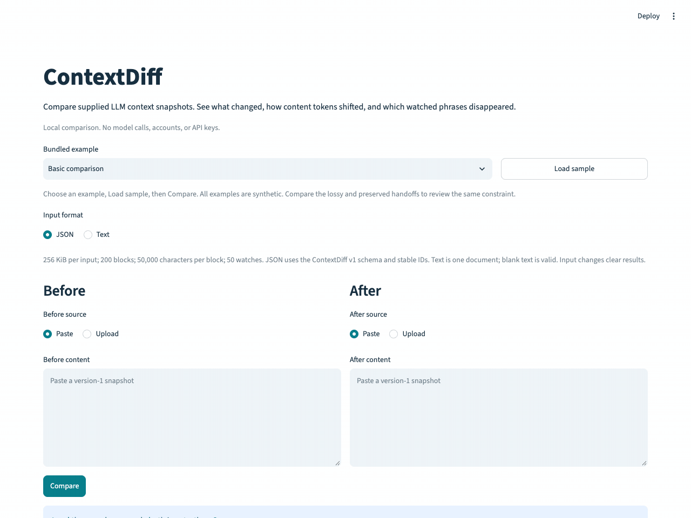

# ContextDiff

Compare two LLM context snapshots to see block changes, token reductions, and missing watched phrases—all locally, without model calls.



Context compression saves tokens, but important information can disappear. A token total alone does not show which instruction or constraint went missing. ContextDiff makes those visible changes reviewable in the supplied before/after snapshots.

In this synthetic demo, the lossy handoff shrinks **271 → 52 tokens** and drops `24-hour idempotency window`. The preserved alternative uses **64 tokens** and includes the phrase in its new summary. ContextDiff compares these handoffs; it does not generate them or assess their semantic correctness.

- **Block changes:** additions, removals, retained and modified blocks, matched by stable IDs.
- **Source evidence:** before/after text, positions, metadata changes, and bounded line diffs.
- **Reference token counts:** totals, deltas, and breakdowns using `cl100k_base`.
- **Watched phrases:** literal checks with matching source IDs, including phrases moved into a summary.
- **Local workflow:** paste or upload JSON/text, try synthetic examples, filter results, and download a full JSON report.

The 24-second animation captures the actual app in Chrome. See the [demo guide](docs/DEMO.md) for the recording method, a static screenshot, and the longer walkthrough. Watches are lexical review signals: paraphrases can be missed and negation can match.

This is an independent engineering demonstration, with no Nessie affiliation or integration. See [research and uncertainty](docs/RESEARCH.md).

## Install and verify

Clone the repository, then run from its root. Python 3.10+ is declared; **only Python 3.12.2 on macOS arm64 has been tested**. Python 3.12 is recommended. Pip resolves dependencies compatible with the chosen Python; the installed Streamlit 1.66.1 itself requires Python 3.11+.

```sh
git clone https://github.com/AarooshB/ContextDiff.git
cd ContextDiff
python3.12 -m venv .venv
source .venv/bin/activate
python -m pip install -r requirements-tested.txt
python -m pip install --no-deps -e ".[dev]"

# Use the same vocabulary cache for warm-up, tests, and later runs.
export TIKTOKEN_CACHE_DIR="$PWD/.venv/tiktoken-cache"
python -c "import tiktoken; tiktoken.get_encoding('cl100k_base')"

python -m streamlit run app.py --server.address 127.0.0.1
```

Tested versions: ContextDiff 0.1.0, tiktoken 0.14.0, Streamlit 1.66.1, pytest 9.2.0, Ruff 0.17.3. [requirements-tested.txt](requirements-tested.txt) records all 42 installed dependency/tool distributions, including pip, without local editable paths. It is a snapshot of the tested macOS/Python environment, not a cross-platform lockfile or compatibility matrix. Isolated build dependencies are resolved separately. To use the broader compatible ranges instead, install with `python -m pip install -e ".[dev]"`; that fresh-install path was also tested.

To run the same checks as [GitHub Actions CI](.github/workflows/ci.yml), keep the warmed cache setting and use:

```sh
python -m pytest
python -m ruff check .
python -m ruff format --check .
```

CI runs on pushes and pull requests with Python 3.12 on Ubuntu, installs `.[dev]`, warms a dedicated tokenizer cache, then runs these three checks. The [Actions page](https://github.com/AarooshB/ContextDiff/actions/workflows/ci.yml) shows actual GitHub run status; local results alone do not establish a passing hosted run.

The full suite passes **141 tests**, including 18 AppTest cases and 9 real-tokenizer integration cases, with no skips. Ruff lint/format and `pip check` pass. Both a fresh range-based install and a second fresh snapshot-based install succeeded. Browser checks cover real uploads/downloads, validation/recovery, filters, literal source, newline differences, and laptop/narrow layout. Exact commands, failures/recovery, environment, timing boundaries, and acceptance evidence are recorded in [PROGRESS](docs/PROGRESS.md).
Installing dependencies and warming an empty tokenizer cache require network access. The warm-up downloads public vocabulary data, never snapshot content. In the installed tiktoken, `TIKTOKEN_CACHE_DIR` selects the cache; absent that setting, `DATA_GYM_CACHE_DIR` or a temporary `data-gym-cache` directory is used. An empty cache setting disables caching. Preserve the warmed cache and use the same setting in later processes. Removing `.venv` also removes this suggested cache.

The warmed app walkthrough passed with external outbound connections denied to the app process by macOS sandboxing, while localhost remained available. Both handoffs, retrieval, uploads, chart, filters, errors, and report download worked with real reference counts. The browser and the rest of the machine were not globally disconnected. [DEMO](docs/DEMO.md) documents this boundary and reproduction; cold-cache failure/recovery also has separate core integration tests.
## Use the local app

Open [ContextDiff on localhost](http://127.0.0.1:8501) after running the launch command above. The config also defaults to localhost, disables usage statistics, and caps upload transport at 1 MiB. Python enforces the stricter 256 KiB cap per input for both paste and upload. No API key is needed. Stop the server with Ctrl+C. File watching is disabled; reload the browser or restart the server after source edits.

1. Choose **Coding handoff · lossy**, click **Load sample**, then **Compare**. Tokens fall from 271 to 52; the `24-hour idempotency window` watch is missing. Switch to **Coding handoff · preserved**, Load sample, Compare: 271 to 64 tokens, and the phrase appears in the new summary. Both have 1 added, 3 removed, 1 retained, and 1 modified block. **Retrieval · source swap** shows a smaller active-context change (38 → 34). **Basic comparison** covers all statuses and a metadata-only edit (30 → 28). Selecting a choice clears the old report; Load sample fills the inputs. All examples are synthetic. [Checked expectations](examples/README.md) explain each identity, count, and watch.
2. For your own inputs, select **JSON** or **Text** explicitly. Each side independently selects **Paste** or **Upload**. JSON accepts the [ContextDiff v1 schema](docs/ARCHITECTURE.md); text becomes one document and supports no authored watchlist. Blank text is valid; blank or malformed JSON produces an error. Commit paste edits by leaving the field or pressing Ctrl+Enter (Cmd+Enter on macOS); committed changes clear the prior result. Switching sources can discard the inactive widget's input; load the sample again to reset both sides.
3. Inspect global token/status totals, expand the native token chart, and review watched phrases with before/after source IDs. Below, filter blocks by status or either side's kind. Filters leave summaries, watches, and the export unchanged. Source panels show one-based positions, role/kind changes, complete text, and bounded line edits; long panels scroll. Retained blocks start collapsed.
4. Click **Download JSON report** to save the full comparison, reference encoding, and limitations. The report contains complete supplied text. Inputs and results stay in local session memory unless you choose to download; the app adds no disk persistence or global input cache.

Validation errors identify the side and correction without echoing private input. Fix the input and Compare again. If reference token setup fails, diffs and watches still work, the UI says **Unavailable**, and token fields in the report are null. Run the warm-up command above with the same cache setting, then Compare again to retry.

Native code panels can hide one leading/trailing newline. Character counts and final-LF labels refer to the actual source; line edits mark missing newlines and the JSON report preserves the exact normalized text. A skipped alignment notice preserves full source text and explains the core work limit.

## Use the engine

```python
import json
from pathlib import Path

from contextdiff import (
    TokenizerUnavailableError,
    compare_snapshots,
    create_token_counter,
    load_json_snapshot,
)

fixtures = Path("tests/fixtures")
before = load_json_snapshot((fixtures / "statuses.before.json").read_bytes())
after = load_json_snapshot((fixtures / "statuses.after.json").read_bytes())

try:
    counter = create_token_counter()
except TokenizerUnavailableError:
    # Diff and watched-phrase results still work; token metrics are null.
    counter = None

report = compare_snapshots(before, after, counter=counter)
print(report.status_counts)
print(json.dumps(report.to_dict(), ensure_ascii=False, indent=2))
```

This synthetic fixture has 1 added, 1 removed, 3 retained, and 1 modified block. It includes a retained privacy phrase, a missing idempotency-window phrase, and an unverified baseline phrase. The fixture's hand-checked word counter is only a test stub; real content-token counts use tiktoken.

Use `load_text_snapshot(data: bytes, *, label: str)` for explicitly selected plain text. It becomes one `document` message block, including when empty. Both loaders normalize CRLF/CR to LF, preserve other content whitespace and final newlines, accept a UTF-8 BOM, and raise `SnapshotValidationError` for invalid inputs. Invalid JSON never falls back to text. Use the loaders at external input boundaries; direct dataclass construction is for trusted, already validated values.

The [version-1 JSON schema and report contract](docs/ARCHITECTURE.md) specify all fields. Inputs are bounded to 256 KiB each, 200 blocks, 50,000 normalized characters per block, and 50 watches. IDs must be unique and stable. Comparisons are deterministic and do not mutate snapshots. Reports contain the supplied text; only save or share them intentionally. Private working inputs belong in the ignored `local_data/` directory.

## Interpretation limits

- Retained means identical content, kind, and role under the same ID. It does not establish model understanding or memory. Different IDs remain additions/removals even with identical content; reordered blocks expose both positions.
- Line alignment uses `difflib` with fixed per-pair and cumulative budgets. If detail is skipped, complete source text and the reason remain in the report.
- “Content tokens · cl100k_base reference” counts content separately per block. It excludes metadata, provider wrappers, hidden context, and billing overhead. A zero baseline has no percentage change. Unavailable metrics are null, never a heuristic or a false zero.
- Only the before watchlist defines checks. Matching uses casefolded, whitespace-collapsed literal substrings within individual blocks, with source IDs. Missing means potential loss for review; paraphrases may be missed, and negated or contradictory text may still match. No watched phrases configured means no preservation assessment.
- Core comparisons need no model API, account, database, or paid service. There is no provider-format detection, semantic matching, summarizer, or Nessie integration.

## Demonstration and verification

Follow [DEMO](docs/DEMO.md) for the animated browser demo, paced script, actual screenshot, results table, offline verification method, and timing reproduction. Warmed engine-only sample medians ranged from 0.024 to 0.072 ms across 100 runs per pair on the tested machine; the repetitive full-source fallback median was 0.560 ms. These exclude parsing, encoding setup, serialization, and UI rendering, and promise no production scalability or model improvement.

Stages 1–3 are complete within the recorded verification boundaries. Other Python versions, operating systems, dependency resolutions, and machine-wide/browser offline operation remain untested. No private data, credentials, publication, deployment, or outreach is needed for this demo. No further stage is scheduled.

## Project documents

- [90-second local demo](docs/DEMO.md)
- [Tested dependency snapshot](requirements-tested.txt)
- [Project scope and success criteria](docs/PROJECT.md)
- [Architecture and snapshot contract](docs/ARCHITECTURE.md)
- [Three-stage implementation plan and acceptance record](docs/PLAN.md)
- [Progress, exact checks, and known limits](docs/PROGRESS.md)
- [Decision log](docs/DECISIONS.md)
- [Research and technical risks](docs/RESEARCH.md)
- [Contribution instructions](AGENTS.md)
