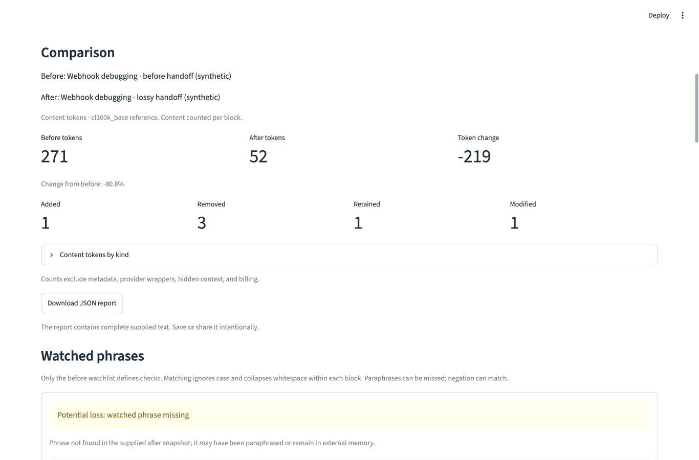

# ContextDiff local demonstration

All inputs are synthetic. This is a comparison of supplied visible context, with
no Nessie affiliation, integration, provider export, or measured model outcome.
Use a laptop browser; the input columns also stack at narrow widths.

## Prepare before presenting

From the repository root, follow [README installation](../README.md). Tested:
CPython 3.12.2, macOS 26.5.2 arm64, tiktoken 0.14.0, Streamlit 1.66.1.
No account, API key, model, or paid service is needed. Install dependencies and
warm the vocabulary while network access is available:

```sh
source .venv/bin/activate
export TIKTOKEN_CACHE_DIR="$PWD/.venv/tiktoken-cache"
python -c "import tiktoken; tiktoken.get_encoding('cl100k_base')"
python -m streamlit run app.py --server.address 127.0.0.1
```

Open [localhost](http://127.0.0.1:8501). Select **Coding handoff · lossy**, click
**Load sample**, then **Compare** once before presenting to initialize the chart
libraries. Return to the top. Keep the same cache setting when restarting.
Installation, first tokenizer setup, and app startup are outside the 90-second
script. File watching is disabled; restart/reload after editing application code.

## 90-second script

Use the time column as a pacing budget. Each sample switch needs **Load sample**
and **Compare**. Scroll from inputs to Comparison and Watched phrases; the totals
and evidence remain global even when block filters change.

| Time | Action | Suggested narration |
| --- | --- | --- |
| 0–10 s | Show the app and lossy choice; Load sample → Compare. | “These are synthetic coding-agent contexts around a webhook retry bug. We compare the supplied text without calling a model.” |
| 10–25 s | Scroll to Comparison. Point to 271 → 52 and the four status counts. | “The smaller handoff removes a verbose trace and adds a summary. Stable IDs show one retained instruction, one edited task, three removals, and one addition.” |
| 25–40 s | Show the first watch and its before/after source IDs. | “The 24-hour idempotency constraint is missing. The atomic-claim finding still appears in the summary. Fewer tokens alone would not show this difference.” |
| 40–60 s | Select Coding handoff · preserved → Load sample → Compare. Scroll to the first watch. | “The alternative uses 64 tokens, twelve more than lossy. The same watched constraint now appears in the new summary, although its original block is still removed.” |
| 60–75 s | Select Retrieval · source swap → Load sample → Compare. Show the source IDs. | “Here one retrieved source replaces another: 38 to 34 tokens. Removal from active context does not prove deletion from external storage. No retrieval service is connected.” |
| 75–90 s | Point to report download and interpretation limits. | “Export includes full source text and evidence. Watches are literal: paraphrases can be missed, and negation can match. Counts use cl100k_base per block, excluding provider wrappers and hidden state.” |

This is a paced demonstration, not a model benchmark. Browser actions and a
93.4-second paced rehearsal are recorded in [PROGRESS](PROGRESS.md); presentation pace
can vary. The saved image below is an actual running-app capture from 2026-10-28,
at a 1366 × 900 viewport. It is not a mockup or a screenshot assertion.



## Checked results

Counts use ordinary supplied content, summed per block. All three Stage 3
comparisons were checked directly with the tokenizer, regression tested, and
inspected in the actual browser.

| Pair | Before → after tokens | Change | Added / removed / retained / modified | Window watch |
| --- | --- | --- | --- | --- |
| Basic | 30 → 28 | -2 (-6.7%) | 1 / 1 / 1 / 2 | missing_after |
| Lossy handoff | 271 → 52 | -219 (-80.8%) | 1 / 3 / 1 / 1 | missing_after |
| Preserved handoff | 271 → 64 | -207 (-76.4%) | 1 / 3 / 1 / 1 | present_after in `handoff-summary` |
| Retrieval swap | 38 → 34 | -4 (-10.5%) | 1 / 1 / 1 / 0 | missing_after |

The handoff `claim` watch moves from `finding` to `handoff-summary` in both
alternatives. `privacy` stays in `instruction`. See
[all identities, per-block counts, and watch expectations](../examples/README.md).
A new summary is added; ContextDiff does not infer a many-to-one identity match.

## Recovery and boundaries

- To reset a custom input, Load sample again. Selecting an example clears results;
  it does not load files until Load sample. Compare always uses the visible inputs.
- Commit pasted edits by blurring the field or Ctrl/Cmd+Enter. The old results and
  download disappear after the rerun. Invalid JSON never becomes plain text.
- The before watchlist alone defines checks. No configured watches means no
  preservation assessment. “Ignore the 24-hour idempotency window” matches;
  “retain keys for one day” does not. Neither outcome establishes correctness.
- Blank Text is one empty document. Empty JSON `blocks` is zero blocks. An absent
  upload is an error. Inputs are capped at 256 KiB; block content at 50,000 chars.
- Native code panels can hide one boundary newline; character/final-LF labels and
  line-edit markers expose the distinction. Export preserves normalized source.
- When line alignment exceeds its budget, full sources remain available. Long
  source panels scroll; this is not production-scale trace ingestion.
- If the tokenizer cache is unavailable, diffs/watches still work with null token
  metrics. Warm the same cache and Compare again. There is no heuristic fallback.

## Warmed-cache offline verification

Installation and cold-cache warm-up require network access. After that, the
complete app flow was exercised with a macOS process sandbox denying external
outbound network connections, with localhost allowed. This covered sample
loading/comparison for both handoffs and retrieval, the chart, actual uploads,
validation/recovery, filters, and report download. External TCP probes failed
with `PermissionError`; localhost and reference counts worked. The browser and
other applications retained their usual networking. This is app-process network
isolation, not a claim that the machine or browser was globally offline.

To reproduce on macOS, after installation/warm-up, stop any server on the target
port and run from the project root:

```sh
export TIKTOKEN_CACHE_DIR="$PWD/.venv/tiktoken-cache"
sandbox-exec -p '(version 1) (allow default) (deny network-outbound) (allow network-outbound (remote ip "localhost:*"))' \
  .venv/bin/python -m streamlit run app.py --server.address 127.0.0.1 --server.port 8503 --server.headless true
```

Open [the isolated demo](http://127.0.0.1:8503). The sandbox profile is specific to
the tested macOS environment and is a verification aid, not an application
runtime requirement. On other systems, disable external networking while keeping
loopback available, restart the warmed app, and follow the script. That
cross-platform isolation method was not tested. `pytest -m integration` also
includes warmed/cold-cache subprocess socket guards; those tests alone cover the
core, not the full browser walkthrough.

## Timing boundary and reproduction

Observed in the fresh environment above, with encoding initialized, snapshots
already parsed, one untimed comparison, then 100 `perf_counter_ns` measurements
of `compare_snapshots(..., counter=counter)` per pair. Timing includes line
alignment, watches, token encoding, and report dataclasses; it excludes file
loading, vocabulary initialization, serialization, Streamlit startup/rendering,
and human interaction. No wall-clock threshold is asserted in tests.

| Pair | Median milliseconds | Maximum milliseconds |
| --- | --- | --- |
| Basic | 0.033 | 0.067 |
| Lossy handoff | 0.070 | 0.145 |
| Preserved handoff | 0.072 | 0.292 |
| Retrieval swap | 0.024 | 0.426 |
| Repetitive fallback | 0.560 | 0.900 |

The repetitive pair is `"repeat\n" * 1001 + "old\n"` versus the same prefix plus
`"new\n"`: 7,011 characters per side. Detail is skipped for more than 2,000 combined
lines and both complete sources survive. These small-sample observations satisfy
the under-one-second aim on this machine and imply no scalability guarantee.

To repeat the sample timing boundary (use the same warmed cache):

```python
from pathlib import Path
from statistics import median
from time import perf_counter_ns

from contextdiff import compare_snapshots, create_token_counter, load_json_snapshot

counter = create_token_counter()
for name in ("lossy", "preserved"):
    pair = [
        load_json_snapshot(Path(f"examples/{file}.json").read_bytes())
        for file in ("handoff.before", f"handoff.{name}.after")
    ]
    compare_snapshots(*pair, counter=counter)
    durations = []
    for _ in range(100):
        start = perf_counter_ns()
        compare_snapshots(*pair, counter=counter)
        durations.append((perf_counter_ns() - start) / 1e6)
    print(name, "median ms", median(durations), "max ms", max(durations))
```

Fresh-install commands, resolved dependency pins, test counts, initial failed
attempts, report validation, and remaining compatibility limits are in
[PROGRESS](PROGRESS.md). No publication, deployment, or outreach was performed.
